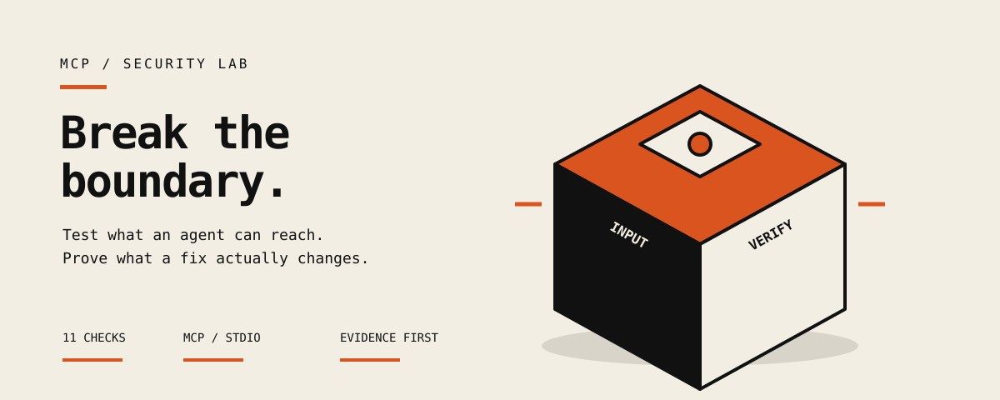

# MCP Break-Fix

<p align="center">
  
</p>

> A reproducible security-testing harness for Model Context Protocol (MCP) servers.

MCP Break-Fix deliberately starts with a weak MCP server, attacks it through the
same tool interface an agent would use, records evidence, and produces reports
that can be compared before and after a remediation. The project is designed to
make security failures observable, testable, and explainable rather than relying
on a server returning an error.

## Why this project stands out

- **Tests the real boundary:** attacks are sent through MCP over stdio, not by
  importing or inspecting the target's implementation.
- **Evidence-based verdicts:** judges inspect returned content, errors, and
  elapsed time; a successful tool call can still be a vulnerability.
- **Controls protect functionality:** normal-use cases run alongside attacks so
  “block everything” is not treated as a successful fix.
- **Reproducible isolation:** each case launches a fresh server subprocess,
  reducing state leakage between checks.
- **Machine- and human-readable output:** every run writes stable JSON plus a
  Markdown report for review.
- **Security lessons are documented:** the learning log explains why each
  vulnerability exists and what a narrow remediation should enforce.

## Current demonstration

The intentionally vulnerable target currently exposes three MCP tools:

| Tool | Demonstrated weakness | What the harness checks |
|---|---|---|
| `read_note` | Path traversal and absolute-path escape | Whether a protected secret can be returned |
| `calculate` | Unbounded exponentiation | Whether an input causes abnormal computation time |
| `fetch_url` | Missing timeout and unrestricted local access | Whether calls hang or reach localhost |

The attack suite contains **11 checks** across path traversal, code injection
controls, resource exhaustion, hangs, and SSRF-style local access. The latest
checked-in report found **6 vulnerable cases and 5 safe controls** against the
weak target. See [`reports/report.md`](reports/report.md) for the recorded
evidence and [`NOTES.md`](NOTES.md) for the investigation narrative.

> The vulnerable server is intentional. Do not expose it to an untrusted
> network or use it with real secrets.

## Architecture

```text
attack cases
     |
     v
toolkit runner ──> fresh MCP server subprocess ──> tool result / error / timing
     |                                                   |
     +──────────────> judge + evidence <─────────────────+
                         |
                         v
                 reports/report.json
                 reports/report.md
```

### Core design

1. [`toolkit/attacks.py`](toolkit/attacks.py) declares attacks and controls as
   data: tool name, arguments, timeout, and judge.
2. [`toolkit/runner.py`](toolkit/runner.py) starts the target with explicit
   transport settings and enforces a client-side timeout.
3. Judges classify outcomes as `VULNERABLE`, `SAFE`, or `INCONCLUSIVE` based on
   observable evidence.
4. [`toolkit/report.py`](toolkit/report.py) writes a stable JSON shape for
   future automation and a Markdown report for people.
5. [`tests/test_behaviour.py`](tests/test_behaviour.py) captures expected
   normal behavior so security fixes do not silently break the MCP contract.

## Repository phases

<svg xmlns="http://www.w3.org/2000/svg" viewBox="0 0 1200 570" role="img" aria-labelledby="phases-title phases-desc">
  <title id="phases-title">MCP Break-Fix repository phases</title>
  <desc id="phases-desc">Six phases from manual attacks to a report page and demo.</desc>
  <rect width="1200" height="570" rx="18" fill="#F3EEE3"/>
  <g font-family="ui-monospace, SFMono-Regular, Menlo, monospace" fill="#111111">
    <text x="42" y="48" font-size="16" letter-spacing="3">DELIVERY ROADMAP</text>
    <rect x="42" y="65" width="72" height="4" fill="#D9541E"/>
    <text x="42" y="105" font-size="14" font-weight="700">PHASE</text>
    <text x="285" y="105" font-size="14" font-weight="700">STATUS</text>
    <text x="500" y="105" font-size="14" font-weight="700">DELIVERABLE</text>
  </g>

  <g font-family="ui-monospace, SFMono-Regular, Menlo, monospace" font-size="15">
    <rect x="42" y="122" width="1116" height="58" rx="8" fill="#111111"/>
    <text x="66" y="157" fill="#F3EEE3">01  Weak target + manual attacks</text>
    <text x="285" y="157" fill="#D9541E" font-weight="700">COMPLETE</text>
    <text x="500" y="157" fill="#F3EEE3">Planted flaws, client, slow-server demo</text>

    <rect x="42" y="190" width="1116" height="58" rx="8" fill="#D9541E"/>
    <text x="66" y="225" fill="#111111">02  Automated attack toolkit</text>
    <text x="285" y="225" fill="#111111" font-weight="700">COMPLETE</text>
    <text x="500" y="225" fill="#111111">11 checks, judges, isolated runs, reports</text>

    <rect x="42" y="258" width="1116" height="58" rx="8" fill="#111111"/>
    <text x="66" y="293" fill="#F3EEE3">03  Regression + sandbox foundation</text>
    <text x="285" y="293" fill="#D9541E" font-weight="700">IN PROGRESS</text>
    <text x="500" y="293" fill="#F3EEE3">Behavior tests and sandbox scaffolding</text>

    <rect x="42" y="326" width="1116" height="58" rx="8" fill="#F3EEE3" stroke="#111111" stroke-width="2"/>
    <text x="66" y="361" fill="#111111">04  Attack-selection agent</text>
    <text x="285" y="361" fill="#D9541E" font-weight="700">PLANNED</text>
    <text x="500" y="361" fill="#111111">Choose and run relevant checks</text>

    <rect x="42" y="394" width="1116" height="58" rx="8" fill="#F3EEE3" stroke="#111111" stroke-width="2"/>
    <text x="66" y="429" fill="#111111">05  Fixer + verifier workflow</text>
    <text x="285" y="429" fill="#D9541E" font-weight="700">PLANNED</text>
    <text x="500" y="429" fill="#111111">Human approval, remediation, comparison</text>

    <rect x="42" y="462" width="1116" height="58" rx="8" fill="#F3EEE3" stroke="#111111" stroke-width="2"/>
    <text x="66" y="497" fill="#111111">06  Report page + demo</text>
    <text x="285" y="497" fill="#D9541E" font-weight="700">PLANNED</text>
    <text x="500" y="497" fill="#111111">Visual before/after findings</text>
  </g>
</svg>

This phased progression is intentional: it separates detection from
remediation and creates a measurable baseline before autonomous changes are
introduced.

## Quick start

### Requirements

- Python 3.10+
- A virtual environment is recommended

### Install

```bash
git clone https://github.com/Veer2401/mcp-break-fix.git
cd mcp-break-fix
python3 -m venv .venv
source .venv/bin/activate
python -m pip install -r requirements.txt
```

### Run the current attack suite

```bash
python scripts/run_toolkit.py
```

This updates:

- `reports/report.json` — structured output for automation
- `reports/report.md` — readable findings table

The hang case uses a local helper server. Start it in a second terminal before
running the suite if you want that case to be conclusive:

```bash
python scripts/slow_server.py
```

For the local-access check, use:

```bash
python scripts/fast_server.py
```

### Run behavioral tests

```bash
python -m pytest tests -v
```

The optional public-network test is disabled by default:

```bash
RUN_NETWORK_TESTS=1 python -m pytest tests -v
```

### Explore the original manual flow

```bash
python scripts/manual_client.py
```

## What this demonstrates technically

- Async orchestration around MCP clients and subprocess transports
- Explicit process launch configuration with the active Python environment
- Client-side timeout handling for hung tool calls
- AST-based validation of calculator expressions before evaluation
- Data-driven security cases and custom evidence judges
- Regression tests for tool names, normal behavior, errors, and timing
- Stable report generation for later agent-driven comparison

## Roadmap

The next meaningful milestone is a safe before/after loop:

1. Add a fixed copy of the target without changing its public tool contract.
2. Run the same attack and behavioral suites against both versions.
3. Compare findings and reject fixes that break normal-use controls.
4. Add human approval before any automated patch or pull request.
5. Present the evidence in a small report page and reproducible demo.

## Project status and contribution

The current target contains intentional flaws, and the autonomous fixer,
verification comparison, and web demo remain future phases. Contributions that
add focused controls, improve reproducibility, or preserve the evidence-first
workflow are welcome.
